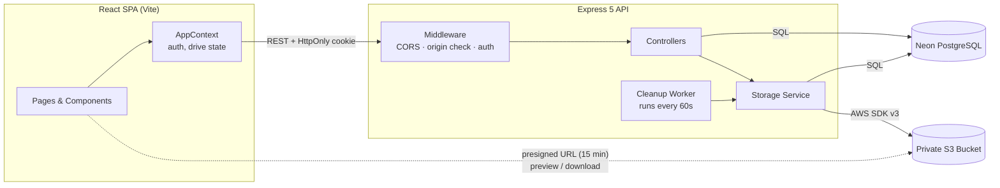
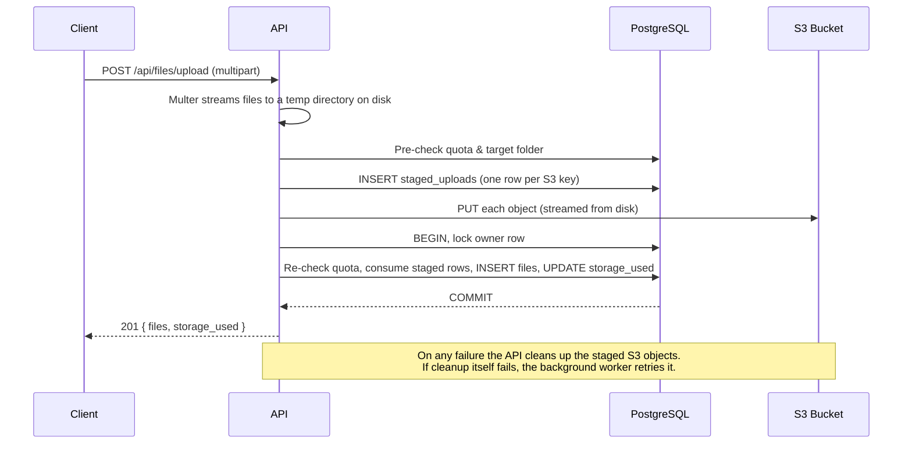
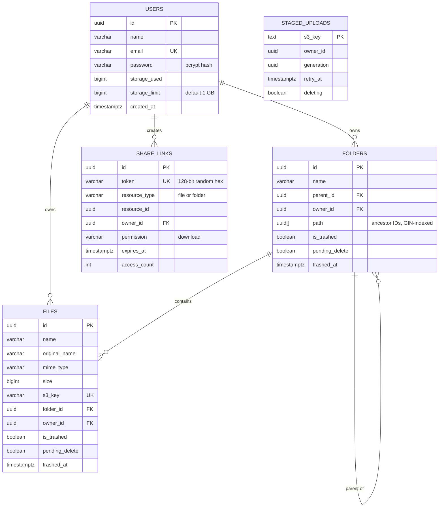

<div align="center">


### Your space in the cloud.

A full-stack, Google-Drive-style cloud storage app built with the **PERN** stack. Upload, organise, preview and share files with per-user storage quotas, a trash with restore, and public share links, all backed by a private S3 bucket and serverless PostgreSQL.

<br />


<!-- Add your live demo link here once deployed:
[**Live Demo**](https://your-deployment-url) · -->
[**Report a Bug**](https://github.com/Ayush-verma25/Stashly_Cloud_Storage_App_PERN/issues) · [**Request a Feature**](https://github.com/Ayush-verma25/Stashly_Cloud_Storage_App_PERN/issues)

</div>

---

## Table of Contents

- [About the Project](#about-the-project)
- [Features](#features)
- [Tech Stack](#tech-stack)
- [Architecture](#architecture)
- [Engineering Highlights](#engineering-highlights)
- [Database Schema](#database-schema)
- [API Reference](#api-reference)
- [Project Structure](#project-structure)
- [Getting Started](#getting-started)
- [Environment Variables](#environment-variables)
- [Testing](#testing)
- [Deployment](#deployment)
- [Security](#security)
- [Known Limitations & Roadmap](#known-limitations--roadmap)
- [Author](#author)
- [License](#license)

---

## About the Project

**Stashly** is a cloud drive where users can register, upload files into a nested folder hierarchy, preview them in the browser, and share them with anyone through a public link.

The project goes beyond basic CRUD. File bytes live in a **private S3-compatible bucket** and are only ever served through short-lived signed URLs. Metadata lives in **PostgreSQL (Neon)**. Storage quotas are enforced under row locks so concurrent uploads can't overshoot a user's limit. Deletion is a **two-phase process** with a background worker that retries failed storage cleanups, so the database and the bucket don't drift apart.

<!--
## Screenshots

Add screenshots to a `docs/screenshots/` folder and uncomment:

| Login | My Drive |
|-------|----------|
|  |  |

| Share Modal | Trash |
|-------------|-------|
|  |  |
-->

---

## Features

### Files & Folders
- **Multi-file upload** (up to 10 files per batch) with a live progress bar
- **Nested folders** of any depth, with breadcrumb navigation
- **Rename** and **move** files and folders, with the folder tree guarded against cycles (a folder can't be moved into itself or its own subfolder)
- **In-browser preview** for images, video, audio and PDFs; other types can be downloaded
- **Search** across file and folder names, **sort** by name, date or size (6 options), and **server-side pagination** (50 per page by default, max 100)

### Sharing
- **Public share links** for files *and* whole folders, with no account needed to open them
- Shared **folders are browsable**: recipients can navigate subfolders and download files, but can never leave the shared subtree
- One link per resource, **view counter**, and one-click **revocation**
- A **Shared Links** dashboard to copy or revoke every link you've created
- The API supports **expiring links**, and expired links return `410 Gone`

### Trash & Storage
- **Soft delete** into Trash, **restore** with the full folder hierarchy intact, **permanent delete**, or **empty trash**
- **Per-user storage quota** (1 GB by default) with a live usage meter in the sidebar
- Moving an item to Trash automatically revokes its share links

### Authentication & UX
- Email and password registration and login, with a **JWT stored in an HTTP-only cookie**
- Protected routes that **redirect back** to the page you were trying to reach after login
- Responsive layout with a mobile drawer navigation
- Accessible dialogs with focus management (`useDialogFocus`) and toast notifications

---

## Tech Stack

| Layer | Technologies |
|-------|--------------|
| **Frontend** | React 19, Vite, React Router 7, Tailwind CSS 4, Axios, Lucide React, React Hot Toast, date-fns |
| **Backend** | Node.js (≥ 24), Express 5, Multer, bcryptjs, jsonwebtoken, cookie-parser, cors |
| **Database** | PostgreSQL on [Neon](https://neon.tech) via `@neondatabase/serverless` (HTTP driver + WebSocket pool for transactions) |
| **Object Storage** | AWS S3 or any S3-compatible service (R2, MinIO, etc.) via AWS SDK v3 and presigned URLs |
| **Tooling** | oxlint, nodemon, Node's built-in test runner (`node --test`) |
| **Deployment configs** | Vercel (`vercel.json` for both client and server) |

---

## Architecture



### Upload flow

Uploads are designed so that a crash at any step can't leave orphaned objects or an inflated quota.



---

## Engineering Highlights

These are the parts of the codebase I'm proudest of and the problems they solve.

**Transactional quota enforcement.**
Every operation that changes storage or the folder tree first takes a `FOR NO KEY UPDATE` lock on the owner's `users` row (`lockOwner`). Concurrent uploads, moves and deletes for one user are therefore serialised, so quota math is always exact and tree edits can't interleave. The lock is weak enough that foreign-key checks on child rows don't block.

**Staged uploads and a self-healing cleanup worker.**
Before touching S3, the API records each intended key in `staged_uploads`. The same transaction that inserts the `files` rows also consumes the staging rows. If the request dies halfway, a worker polls every 60 seconds and deletes any abandoned objects. Each cleanup attempt gets a fresh `generation` UUID, so a stale worker can never acknowledge a newer job.

**Two-phase permanent deletion.**
Permanent delete first flags rows as `pending_delete` inside a transaction (and removes their share links). Only then does it delete from S3, removing each DB row and decrementing the quota *per file* using `DELETE ... RETURNING`, which keeps the accounting idempotent even if the request and the retry worker race on the same key. If S3 is unavailable, the rows stay flagged and the worker finishes the job later.

**Complete S3 cleanup, including versions.**
`deleteFromStorage` lists every object version and delete marker for a key and removes them in batches of 1000, so deleting a file also works correctly on versioned buckets.

**Materialised-path folder tree.**
Each folder stores its ancestry as a `UUID[]` `path` column with a **GIN index**. Fetching or trashing an entire subtree is a single indexed query (`path @> ARRAY[id]`) instead of a recursive walk. Moving a folder rewrites its descendants' paths in the same transaction.

**Backpressure on uploads.**
Uploads are spooled to disk rather than held in memory, with strict limits on file size, file count and form fields. At most 4 upload batches run at once; beyond that the API replies `503` with `Retry-After`. Temp directories are always removed in a `finally` block.

**Race-safe client state.**
The React context tags every drive request with an incrementing ID and discards stale responses. Auth actions are queued and versioned with an "auth generation" counter, so a slow `/me` response can't overwrite a newer login or logout, and switching users resets all drive state. If deleting the last item on a page leaves it empty, the client steps back to the previous page.

---

## Database Schema

Tables are created automatically on server start (`initDB`), so there are no migrations to run for a first setup.



---

## API Reference

All routes are prefixed with `/api`. Routes marked 🔒 require the auth cookie. Every state-changing request (`POST`, `PATCH`, `DELETE`) must come from an allowed `Origin`.

### Auth: `/api/auth`

| Method | Endpoint | Description |
|--------|----------|-------------|
| `POST` | `/register` | Create an account. Returns an identical response whether or not the email already exists, to prevent account enumeration |
| `POST` | `/login` | Verify credentials and set the `token` cookie |
| `POST` | `/logout` | Clear the auth cookie |
| `GET` 🔒 | `/me` | Current user profile and storage usage |

### Folders: `/api/folders` 🔒

| Method | Endpoint | Description |
|--------|----------|-------------|
| `POST` | `/` | Create a folder (`name`, optional `parent_id`) |
| `GET` | `/` | List folders. Query: `parent_id`, `search`, `all=true` |
| `GET` | `/:id` | Folder details plus the breadcrumb trail |
| `PATCH` | `/:id/rename` | Rename |
| `PATCH` | `/:id/move` | Move (body: `target_parent`) |
| `DELETE` | `/:id` | Move the folder and its contents to Trash |
| `POST` | `/:id/restore` | Restore from Trash |
| `DELETE` | `/:id/permanent` | Permanently delete a trashed folder and everything inside |

### Files: `/api/files` 🔒

| Method | Endpoint | Description |
|--------|----------|-------------|
| `POST` | `/upload` | Upload up to 10 files (`multipart/form-data`, field `files`, optional `folder_id`) |
| `GET` | `/` | List files. Query: `folder_id`, `search`, `sort`, `page`, `limit` |
| `GET` | `/:id/preview` | Get a 15-minute presigned URL for preview or download |
| `PATCH` | `/:id/rename` | Rename |
| `PATCH` | `/:id/move` | Move (body: `target_folder`) |
| `DELETE` | `/:id` | Move to Trash |
| `POST` | `/:id/restore` | Restore from Trash |
| `DELETE` | `/:id/permanent` | Permanently delete (also frees quota) |

`sort` accepts: `name_asc` · `name_desc` · `date_asc` · `date_desc` · `size_asc` · `size_desc`

### Trash: `/api/trash` 🔒

| Method | Endpoint | Description |
|--------|----------|-------------|
| `GET` | `/` | List all trashed files and folders |
| `POST` | `/empty` | Permanently delete everything in Trash |

### Shares: `/api/shares`

| Method | Endpoint | Description |
|--------|----------|-------------|
| `GET` | `/access/:token` | **Public.** Resolve a share link. For folders, accepts `?folder_id=` to browse subfolders |
| `POST` 🔒 | `/` | Create or fetch the share link for a file or folder |
| `GET` 🔒 | `/` | List the current user's active share links |
| `DELETE` 🔒 | `/:id` | Revoke a share link |

### Health

| Method | Endpoint | Description |
|--------|----------|-------------|
| `GET` | `/healthz` | Verifies database connectivity (`SELECT 1`) |

---

## Project Structure

```
Stashly_Cloud_Storage_App_PERN/
├── client/                        # React + Vite frontend
│   ├── public/                    # Logo, favicon, background pattern
│   ├── src/
│   │   ├── components/
│   │   │   ├── auth/              # ProtectedRoute
│   │   │   ├── files/             # FileGrid, FileCard, FilePreview, Share/Move/Rename modals
│   │   │   ├── folders/           # FolderCard, CreateFolderModal
│   │   │   ├── layout/            # DashboardLayout, Sidebar, Header, Breadcrumbs
│   │   │   └── ui/                # Button, Input, Modal, Dropdown, ConfirmDialog, ...
│   │   ├── config/api.js          # Axios instance (credentials enabled)
│   │   ├── context/AppContext.jsx # Auth + drive state
│   │   ├── hooks/                 # useDrive (actions), useDialogFocus (a11y)
│   │   └── pages/                 # Login, Drive, SharedFile, SharedWithMe, Trash
│   ├── vercel.json                # SPA rewrite
│   └── vite.config.js
│
├── server/                        # Express API
│   ├── config/                    # db.js (Neon + transactions), s3.js, env.js
│   ├── controllers/               # auth, file, folder, share, trash
│   ├── middlewares/               # auth, upload, verifyOrigin, errorHandler
│   ├── routes/                    # Route definitions
│   ├── services/storageService.js # Hierarchy ops, purge logic, cleanup worker
│   ├── utils/                     # s3Helper.js, validation.js
│   ├── tests/                     # auth, shares, upload tests
│   ├── server.js                  # App bootstrap
│   └── vercel.json
│
└── README.md
```

---

## Getting Started

### Prerequisites

- **Node.js 24 or newer** (the server enforces `engines.node >= 24` and needs a global `WebSocket`)
- A **PostgreSQL database on [Neon](https://neon.tech)** (free tier works)
- A **private S3 bucket** (AWS S3, or any S3-compatible service such as Cloudflare R2 or MinIO)

### 1. Clone the repository

```bash
git clone https://github.com/Ayush-verma25/Stashly_Cloud_Storage_App_PERN.git
cd Stashly_Cloud_Storage_App_PERN
```

### 2. Set up the server

```bash
cd server
npm install
cp .env.example .env
```

Open `server/.env` and fill in your values (see [Environment Variables](#environment-variables)). To generate a strong JWT secret:

```bash
node -e "console.log(require('crypto').randomBytes(48).toString('hex'))"
```

Start the API (tables are created automatically on boot):

```bash
npm run dev
# Server is running on http://localhost:8000
```

### 3. Set up the client

In a second terminal:

```bash
cd client
npm install
cp .env.example .env     # VITE_BASE_URL=http://localhost:8000
npm run dev
```

Open **http://localhost:5173**, create an account, and start uploading.

### 4. Configure bucket CORS

Because the browser previews and downloads files directly from S3 using signed URLs, your bucket needs a CORS rule allowing `GET` from your client origin (e.g. `http://localhost:5173`).

---

## Environment Variables

### Server (`server/.env`)

| Variable | Required | Default | Description |
|----------|:--------:|---------|-------------|
| `ORIGINS` | ✅ | n/a | Comma-separated list of exact browser origins allowed by CORS and the origin check (no trailing slashes or paths) |
| `DATABASE_URL` | ✅ | n/a | Neon PostgreSQL connection string |
| `JWT_SECRET` | ✅ | n/a | Secret for signing tokens. **Must be at least 32 bytes** |
| `AWS_REGION` | ✅ | n/a | Bucket region |
| `AWS_S3_BUCKET` | ✅ | n/a | Name of the private bucket |
| `AWS_ACCESS_KEY_ID` / `AWS_SECRET_ACCESS_KEY` | ❌ | n/a | Optional when running with an IAM role. If you set one, set both |
| `AWS_ENDPOINT_URL_S3` | ❌ | n/a | Custom endpoint for S3-compatible providers (enables path-style addressing) |
| `PORT` | ❌ | `8000` | API port |
| `NODE_ENV` | ❌ | n/a | Set to `production` for `Secure`, `SameSite=None` cookies |
| `MAX_FILE_SIZE` | ❌ | `104857600` | Max size per file in bytes (100 MB) |
| `MAX_STORAGE_PER_USER` | ❌ | `1073741824` | Storage quota per new user in bytes (1 GB) |

The server **fails fast at startup** with a clear message if anything required is missing or malformed.

### Client (`client/.env`)

| Variable | Description |
|----------|-------------|
| `VITE_BASE_URL` | Origin of the API, e.g. `http://localhost:8000`. Leave empty to use the same origin behind a reverse proxy that serves the API under `/api` |

> ⚠️ Never commit `.env` files. They are already covered by `.gitignore`.

---

## Testing

The server uses Node's built-in test runner, so there are no extra test dependencies.

```bash
cd server
npm test
```

The suite covers:
- **Startup validation**: missing, empty and short `JWT_SECRET`
- **Auth**: registration (including race conditions and non-disclosure of existing accounts), login, cookie flags in dev vs. production, logout origin checks, invalid or expired tokens, deleted users
- **Error handling**: no internal details leaked to clients, database constraint codes mapped to safe responses, upload-limit errors
- **CSRF protection**: unsafe methods require an allowed `Origin`
- **Sharing**: permission and expiry validation, folder shares resolving descendants without exposing storage keys
- **Uploads**: disk-backed multipart handling and temp-file cleanup

Frontend checks:

```bash
cd client
npm run lint     # oxlint
npm run build    # production bundle
```

---

## Deployment

Both packages ship with a `vercel.json`:

- **Client**: deploys as a static Vite build with an SPA rewrite so deep links like `/drive/:id` and `/s/:token` work.
- **Server**: configured for `@vercel/node`.

**Checklist before going live**

1. Serve both client and API over **HTTPS**, and set `NODE_ENV=production`.
2. Set `ORIGINS` to your deployed client origin(s) and `VITE_BASE_URL` to your API origin.
3. Keep the bucket **private**, add a CORS rule for signed downloads, and use a least-privilege IAM role or key.
4. Enable database backups and monitoring.
5. Put an external rate limit or WAF in front of the auth and public share endpoints.

> **Hosting note:** the API relies on a background timer (cleanup worker) and on-disk upload staging. Serverless platforms don't keep timers alive between requests and cap request body sizes, so for production uploads a long-running Node host (Render, Railway, Fly.io, an EC2 instance, etc.) is the more robust choice for the API.

---

## Security

| Concern | How it's handled |
|---------|------------------|
| **Password storage** | bcrypt hashes; passwords over bcrypt's 72-byte limit are rejected at registration |
| **Session tokens** | JWT (7-day expiry) in an `HttpOnly` cookie, `Secure` and `SameSite=None` in production, `Lax` in development |
| **CSRF** | All unsafe methods require an `Origin` header matching the strict allow-list; `null` origins are rejected |
| **Account enumeration** | Registration returns the same response for new, existing and racing sign-ups, and never starts a session |
| **File access** | The bucket is private; clients only ever receive presigned URLs that expire after 15 minutes |
| **Authorisation** | Every query is scoped by `owner_id`; share-link folder browsing is restricted to the shared subtree |
| **Share tokens** | 128-bit random tokens; public share responses never expose storage keys; responses are `no-store` |
| **Input validation** | Name length and NUL-byte checks, UUID validation, whitelisted sort columns, parameterised SQL throughout, and a 10 KB JSON body limit |
| **Upload abuse** | Size, count and field limits, bounded concurrency, per-user quota |
| **Headers** | `X-Content-Type-Options`, `X-Frame-Options: DENY`, `Referrer-Policy`; `X-Powered-By` disabled |
| **Error handling** | Internal errors are logged server-side only; clients get generic messages |

---

## Known Limitations & Roadmap

**Current limitations**
- No email verification or password-reset flow, which should be added before accepting public sign-ups
- Share links are download-only and the UI doesn't yet let you set an expiry date (the API supports it)
- Uploads go through the API server rather than directly to S3

**Roadmap**
- [ ] Drag-and-drop uploads
- [ ] Email verification and password recovery
- [ ] Expiry picker and password protection for share links
- [ ] Multi-select and bulk actions
- [ ] Direct-to-S3 multipart uploads for very large files
- [ ] Per-endpoint rate limiting
- [ ] Image thumbnails
- [ ] CI pipeline (lint, build, test on every push)

---

## Author

**Ayush Verma**

- GitHub: [@Ayush-verma25](https://github.com/Ayush-verma25)

If you found this project useful or interesting, consider giving it a ⭐

---

## License

Distributed under the **MIT License**. See [`LICENSE`](LICENSE) for details.
